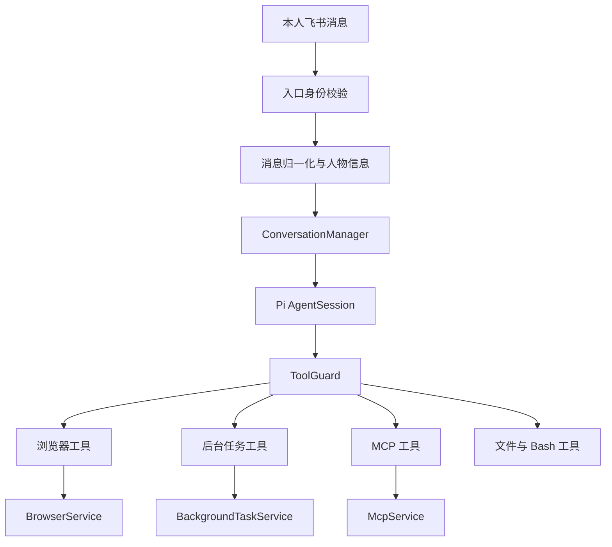

# 架构

feishu-pi 是一个个人 Agent。Pi 负责模型与工具循环；工程负责交互入口、权限、执行服务和运行数据。没有团队分组或多用户授权模型。

## 调用链

## 模块边界

服务层管理状态与资源，不依赖飞书 SDK 或 Pi AgentSession。工具层把参数转给服务，把结果转成 Pi 内容块，不创建第二份状态。`AssistantServices` 装配四个服务，`main.ts` 注入身份通道、通知投递和前端。

| 模块 | 状态与职责 |
|---|---|
| `feishu/` | 飞书接入层：WebSocket 长连接、消息归一化、卡片流式更新与回调、指令解析、用户授权、附件下载、语音转写、表情回复 |
| `runtime/` | Pi 运行时封装：ConversationManager 会话顺序、SessionStore 会话目录、系统提示装配、CLI 代理、身份 bash、数据清理 |
| `assistant/` | 个人能力装配与敏感内容过滤；不承载各能力业务逻辑 |
| `memory/` | 有原话依据的分域事实记忆、相关性选择、后台提炼；不改人格 |
| `conversation/` | 近期实际送达回复和时间资料、对话评测；不虚构生活或随机心情 |
| `proactive/` | 指定群的低频主动接话；过时话题、自己最后发言或生成期间出现新消息时不发 |
| `browser/service.ts` | 唯一个人浏览器队列、配置、持久化 profile、CLI argv；按需启动 |
| `tasks/service.ts` | 进程树、凭证代理租约、超时、限流、日志、任务记录、通知 |
| `mcp/service.ts` | 按需连接、发现、调用、配置过滤、取消、断线回收 |
| `schedule/service.ts` | 定时任务调度：cron/interval 注册、持久化、执行日志 |
| `process/` | 系统环境白名单、直接 argv 执行、进程树终止 |
| `permission/` | 个人规则解析、匹配和 mtime 缓存 |
| `guard/` | 确定性判定、ask 模型审核、本人确认卡 |
| `stickers/` | 图库目录 mtime 缓存、加权检索、按 ref 或情绪取图；返回画面摘要而非本地路径，单包 metadata 损坏只降级该包；最近发送记录（进程内）对搜索与直取统一降权 |
| `tools/` | 本地工具发现、校验、脚本适配与 Pi 工具注册 |
| `resources/` | 资源清单目录、persona 版本管理、Pi 原生加载 |
| `utils/` | 共享工具：日志、凭证保险箱、`.env` 读写、实例锁、JSON 存储、消息内容提取、会话路径、shell 命令 |
| `bilibili/` | B 站自动化：定时决策、视频操作（仅管理员私聊启用后运行） |

## 身份

`FEISHU_PI_OWNER` 绑定本人。推荐直接填写机器人应用对应的 Open ID。旧 `FEISHU_PI_ADMIN` 仅作为迁移来源；姓名只从本地资料缓存匹配，邮箱可定点查询，不枚举通讯录。

传输层在资料查询、下载和 Agent 调用前拒绝其他发言人；卡片回调同样校验本人。运行时再次校验会话身份。个人部署仍保留独立会话和消息中的发言人信息，引用及历史内容不能自动变成执行指令。

旧群聊历史只在明确属于本人时进入个人检索。旧定时任务只恢复本人创建的条目。

## 权限

`deny > risk:high > ask > allow > default deny`。`ask` 才调用审核模型；模型失败或未配置回退本人确认。高风险标记覆盖 allow 和模型放行。

后台 start 投影为额外的 Bash 调用，MCP call 投影为具体工具调用，浏览器 upload 投影为 Read 调用；先检查所有投影的 deny，再审核 ask。不能用 `Tools(background_task)` 或 `Tools(mcp)` 覆盖底层规则。

复合 Bash 规则检查原命令、可解析的命令段与 CLI 归一化命令。规则是调用参数门禁，不是 OS 沙箱，无法穷尽任意程序内部行为。

## 生命周期

- 开机不启动浏览器、MCP 服务或模型心跳。
- 后台任务启动时取得身份通道租约，结束、取消或超时时关闭代理和进程树；日志限制 10 MiB。
- 重启后旧后台记录标记 interrupted，不自动恢复进程或重新执行命令。
- 正常退出停止定时调度，关闭后台任务、浏览器和 MCP，断开前端并释放实例锁。
- MCP 调用失败或断线不自动重放，避免重复副作用；下次操作可以重新连接。

依赖锁定于 `package-lock.json`；协议细节交给官方 MCP SDK 和 Playwright CLI。

### 飞书客户端收藏表情缓存

通过 `.env` 的 `FEISHU_PI_STICKER_CACHE_DIR` 显式指定一个已登录账户的 `resources/stickers` 目录（留空关闭）。接收与引用的 sticker 消息按真实 `file_key` 精确查找同名 PNG/JPEG/WebP/GIF，不按时间猜图，不遍历其他账户，不调用公开资源下载接口。路径穿越、越界链接、过大文件或解码失败均视为未取得图片。该能力属于入站附件处理，不向普通用户提供本地文件工具或目录内容。

匹配后将原图复制到本会话 `images/`，经现有 Pillow 预览器转换为有界 PNG；动图提供时间线上多帧。重复消息独立处理并复用同一缓存来源。客户端没有加载的新表情仍可能缺失，机器人不会自动打开客户端、收藏或等待补发；当前轮明确提示模型画面未知。只读缓存不会自动纳入可发送图库，也不会自动生成图库描述文件。

本机实测三条消息的 `file_key` 与缓存文件去除扩展名后的名称完全一致；不同来源和客户端版本仍可能不命中。配置更改与代码更改需重启服务。
