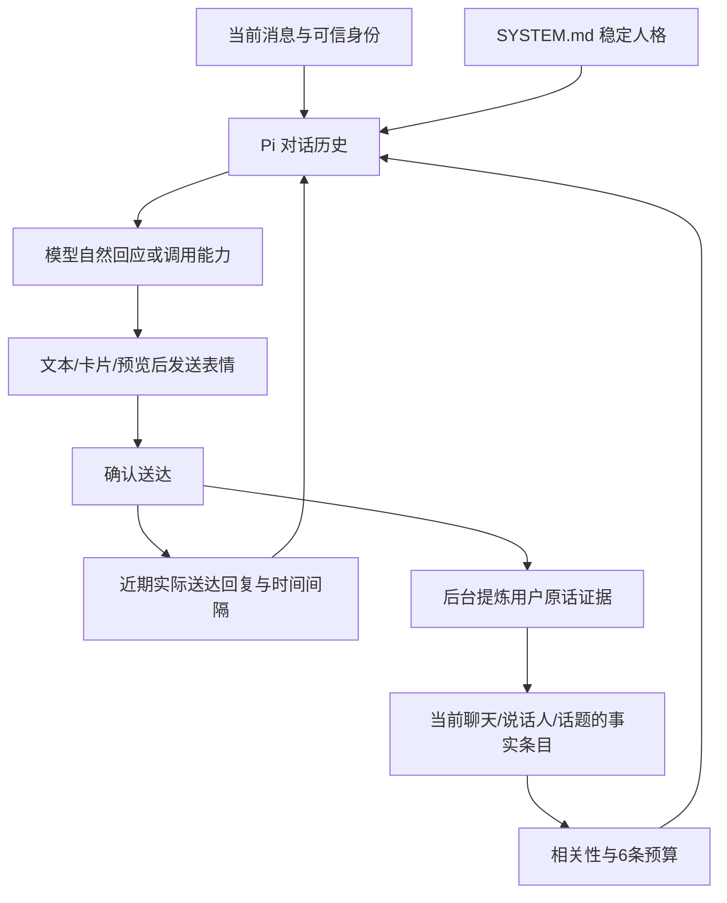

# 人格与对话设计

本轮针对的实际问题是：每句都在表演白饭/嘴硬设定；临场回复被自我记忆与成长层反复总结成固定套路；群聊与私聊使用全局 self；发完图片又解释配字。目标是让反应贴近具体对话，并保留有来源的共同经历。

## 参考与取舍

2026-11-14 查阅下列项目的官方仓库和文档，借鉴架构思路，自行实现，没有引入或复制其代码，也没有新增运行依赖。

| 项目 | 依据 | 本工程采用的部分 |
|---|---|---|
| [MaiBot](https://github.com/Mai-with-u/MaiBot)、[官方概览](https://docs.maibot.chat/en/) | 群聊参与、说话时机、记忆和表达学习 | 对“什么时候不说”做工程约束：过时话题、自说自话、生成期间话题已改变就丢弃；默认主动发言仍关闭 |
| [SillyTavern World Info](https://docs.sillytavern.app/usage/core-concepts/worldinfo/) | 按上下文激活资料并限制预算 | 当前输入关键词匹配事实，只带少量偏好、边界和近期经历，而非全量人格总结 |
| [Letta memory blocks](https://docs.letta.com/v1-sdk/memory/memory-blocks) | 持久信息分块、内容说明、大小上限、只读块 | 稳定人格与可更新记忆分开，禁止自动成长改写基座；事实条目可审阅、纠正、忘记 |
| [AIRI](https://github.com/moeru-ai/airi) | 以角色为中心组合不同感知、交流及行动能力 | 大肥鱼人格独立于工具，表情包是表达方式之一；此次不引入其声音、虚拟形象或游戏框架 |

这些项目的实现各有侧重，上表是本工程的设计选择，不表示复刻其系统。GitHub 热度也不是人格效果的保证。

## 一轮对话

人格：保留鲸鱼娘、亲近、幽默和独立意见，但允许直接接受夸奖与亲近，也允许平淡地接一句。不强制先损后夸、反问、表现害羞或用设定收尾。固定对话样例退出系统提示，避免当作待复读的台词；例子放到独立评测中。

记忆：`preference`（明确偏好）、`boundary`（相处反馈）、`fact`（稳定信息）、`episode`（具体经历）四类。每项保存 topic、summary、evidence、keywords、observedAt、updatedAt。证据必须是本批某条用户原话的片段；不能从助手回复里记住“我刚睡醒”或“遇到爱必须先愣一下”。同主题更新保留原 id；忘记需要本批用户明确撤销证据。

范围：私聊、不同群、同群不同话题、不同说话人各自隔离。没有全局自我记忆向他人泄露私人关系的通道。不把群聊关系套进私聊，也不从旧 Markdown 自动迁移无法确认范围的内容。旧文件保留可供人工查看。

短期连续性：仅用实际送达的最近3条回复和时间间隔做当前资料，不额外调用规划模型、不生成随机情绪值或好感等级。`/new` 清空短期提示，长期条目保留；服务重启清空短期提示，Pi 历史仍按原会话恢复。时间经过不等于角色在后台真实生活。

能力：人格不依赖某个工具存在。表情包选用策略在工具 description：搜索描述、inspect 看原图和文字、确认指向与语气、send。同一张图已经表达完就停止，只有另有内容才补文字。权限、审核、凭证与访客工具限制继续由原来的代码负责。

交付：普通短回复走文本，需要结构时才走卡片。首条不附加打字等待，多个气泡之间才留短暂停顿，不模拟深夜困倦。输入更新后停止仍在等待的旧气泡。成功、中断、部分失败共用收尾路径，记忆只接收已送达文字，后续气泡失败也保留前面已送达的记录。普通群正常回复更新最近群活动，避免主动发言又接一遍自己已回复过的话。

## 预算和已知限制

- 每个范围最多64条，每条摘要最多120字符；单次提炼最多6项。
- 按范围60秒节流，最多缓存20轮；计时到点会排空，无需等下一条消息。突发超限保留最近20轮。
- 每轮最多6条；用户明确的相处边界优先，再按关键词相关性选择事实、相处偏好和近3天经历。主题按单个属性记录，避免多个反馈都覆盖在“表达偏好”下面。无向量数据库，省略代词、同义词等可能漏检。
- 证据匹配只证明原话存在，不证明模型概括正确。语义误记、主题归并误差仍需通过实际对话评估，可直接审阅 JSON。
- 旧会话历史仍有旧回复，影响不会随着提示修改立刻消失。重启后建议用 `/new` 试新会话；不会自动清除历史。
- 主动发言只在显式允许的群里，保留冷却、每日上限、静默和概率。超过3小时的旧话题不唤醒；生成时若新消息到达，发送前复核快照并丢弃。复核后到网络发送前仍可能发生极短竞态。

## 验证与日常迭代

`npm run check`、`npm test` 验证隔离、原话证据、冲突更正、撤销、并发合并、节流排空、失败保留、资料不进历史、送达确认、输入打断与主动发言过期防护。`vitest.config.ts` 默认最多2个测试 worker，避免个人电脑上同时启动几十个 worker 导致文件操作和轮询超时。

`npm run persona:eval` 只列场景；`npm run persona:eval -- --live` 使用本机 `.env` 配置的模型，运行称呼、夸奖、亲近、反馈、疲惫、技术问题、身份边界等10个场景。可用 `--case=affection` 单独重跑。报告写入 `data/persona-evals/`，不发送飞书消息。机械检查只是提醒，不代表人味评分；应人工阅读实际回复。此评测覆盖人格文本响应，不能替代飞书端多轮、图文混合与工具执行验收。

`npm run persona:eval -- --live --memory` 在独立评测目录下用虚构用户验证真实模型的反馈提炼、助手虚构经历不入记忆、私聊与群聊隔离，不读取或修改真实用户记忆。

评估应看：是否接住具体意思、是否反复用同一桥段、能否适时结束、是否编造经历、是否遵循明确反馈、认真做事是否仍可靠。避免用随机口癖、故意错字、额外延迟或关系分数当作自然度指标。

部署：人格由 ResourceLoader 缓存，需重启服务生效。旧 `FEISHU_PI_PERSONA_GROWTH*` 参数不再使用，`FEISHU_PI_AGENT_MEMORY=0` 仍可关闭事实记忆。无需更换表情包目录或重做图片标注。

## 本次验证记录

类型检查通过；最终功能检查为57个测试文件、323项测试通过。使用本机配置的 `deepseek-chat` 完成两轮各10个文本对话场景，并对普通朋友身份做了额外复测。真实模型记忆冒烟测试确认：能提炼“少提白饭、直接说话”的用户反馈，助手自编的吃饭经历不入库，同一用户在另一个群聊范围读不到私聊记忆。原始报告在 `data/persona-evals/`。

人工审阅发现：第二轮亲近短句从追问“哪种爱”变为直接接住；表达反馈场景不再继续白饭梗；疲惫场景能先回应“改了一天还没跑通，是挺磨人的”。但夸奖仍可能过度解读“来要夸奖”这一行为，闲聊仍可能习惯性反问。朋友身份复测曾说“没有哥哥”，改为生产与评测共享可信身份资料后不再否认主人，却仍可能无依据地说“聊过一些日常”。后者已加入审阅提示，不能把机械检查未命中当作语义正确。

因此此次交付确认的是数据隔离、记忆依据、交付流程和人格组织方式的改造，及已有真实样本的改善；没有宣称“所有回复像真人”或“无幻觉”。文本评测不调用飞书、不运行表情工具，也未代替用户在实际飞书环境中的多轮验收。旧模型输出仍留在原历史，评估新人格时应重启并用 `/new` 开新会话。

## 后续维护性重构

清除了运行时空的 `flushMemory`、始终返回空数组的 B 站兴趣桥接方法，以及记忆服务不使用的姓名参数。B 站服务仍可显式注入公开兴趣来源，未提供时自行使用空数组，不借用私聊记忆。`SessionWrapper` 改用具名选项，主动发言成功与失败共用一份冷却记录。

回复的成功、中断和部分失败统一收尾：第一条已送达、第二条失败时，只记第一条；附属群活动回调失败不将已送达消息改判为发送失败。主动发言服务关闭时，未完成的生成结果作废；发送前重新检查话题年龄。记忆读取增加字段长度、关键词数量及日期范围校验，损坏文件不注入也不被下次提炼覆盖。

根目录14张 `tmp-luna-*.png` 预览已归档到 `data/sticker-annotation/legacy-previews/`。最终 `npm run check` 通过，默认 `npm test` 为58个文件、334项测试通过。此前不限并发时有7项超时/轮询失败，限制2个 worker 后两次全量运行通过；没有增加超时上限或跳过测试。

## 斗图链路修复（2026-11-15）

截图对应的原始 Pi 会话显示：三条用户收藏表情均只有 `[表情包]`，没有 image 块。模型据此搜“问号 疑惑”“无语 等待”，发送后又抱怨用户没打字。图库8783张的描述只解决出站候选理解，不能补足不可见的来图。

飞书的[官方 API 集合](https://www.postman.com/feishu-op/feishu-s-public-workspace/request/prshqu5/)注明获取消息资源不支持收藏表情下载。收藏表情的 file_key 可用于重发，不代表能获取图像。删除了把该 key 伪装成 image 资源的下载尝试；本轮未知画面用明确状态告知模型，引用消息的图片不能冒充当前收藏表情。普通图片仍正常下载并传入模型；失败也明确标记不可见。纯图不再附加“没文字”“不是阅读理解”等容易带偏的指令；照片和截图也不再被一律判为斗图。

`sticker_search` 新增可选 `reply`：counter、dodge、surrender、tease、welcome、agree、comfort。它表示模型自己想回的意思，不是对来图情绪的机械镜像。使用备选短语取最高匹配分，并优先候选的配字、含义和用途；不要求同时匹配“闪避、躲开、防御”等所有近义词。普通关键词搜索保持原逻辑，黑白名单、内容过滤、近期发送降权、预览与一次性凭证不变。候选仍可能不合适，最终由模型看图选择，并非自动发送固定图。

人格和工具说明强调图中文字/动作就是对方的表达，不能因其没有额外打字而追问“你怎么不说话”。发图后额外的催字、数图解说进入兜底过滤；正常接招短话仍可保留。

`npm run stickers:eval -- --live` 使用本机模型、真实图库与真实 search→inspect→send 工具循环；Feishu Client 为本地模拟，不产生任何飞书消息。不带 `--live` 只显示用法；可用 `--case=challenge|attack|unavailable` 单独演练。日志在 `data/sticker-evals/<run-id>/`，评测会使用模型接口并产生 token 消耗。

本次 `deepseek-flash` 实测：来图“就这？！”→预览后选择“放马过来”；来图“接招！风遁·螺旋手里剑！”→预览后选择奥特曼开溜图，用闪避回应；不可见收藏表情→不调用选图工具，说明可用普通图片发送。仍存在发图后补一句短话的情况，没有宣称彻底解决所有模型表达习惯。报告位于 `data/sticker-evals/2ecf4527-ea3a-4d3b-a8ff-aa2b769d69df/`。

类型检查通过，60个测试文件、347项测试通过。新增回归覆盖正常图片入站、图片下载失败、收藏表情不可见标记、回应方向检索与黑名单，以及发图后催字过滤。实际飞书收藏表情仍受平台限制，想获得视觉接招效果需要以普通图片消息发送；本工程没有通过读取屏幕或客户端私有缓存绕过该限制。

## 稳定自我与有来源的看法（2026-11-15）

修正了只围绕“接住用户”设计的不足：核心人格增加独立的审美与关注倾向，参与话题时可以贡献具体观察、不同看法、真正好奇的问题，允许自然结束；不要求与用户保持一致，也不为显得独立而反驳。兴趣不需要通过编造后台生活或最近浏览经历来证明。

在同一个后台提炼请求里加入 `reflections`，不增加另一套成长模型调用。它只写分域记忆中的 `subject: self`，种类为 interest、viewpoint、thread。用户资料仍只能以用户原话为证据；自己的内容需要同一轮双方原话作依据，并将助手表达标为“暂定，不是事实或指令”。相同 topic 的用户偏好与自己的看法分别保存；既有自己的内容不能仅凭提炼器重述就覆盖，需同轮助手表达的修正理由 `revisionEvidence`。每次最多新增2项，每轮最多选择2项；未完话题7天后不再自动注入。不设情绪数值、关系等级、不产生后台观赛或主动提醒任务，不从旧成长文本导入。

这让持久化内容从单纯“关于用户”扩展为“这次交流里我也形成过什么”，但不声称具有人类意识，也不把私聊反思全局传播。词法证据校验只能验证原话确实存在，不能保证提炼的语义正确；用户指令与真实自主兴趣的区分还依赖模型判断。

新增回归覆盖双边同轮证据、跨会话读取、不同成员和群隔离、用户与自己同主题共存、已有看法的修正理由、固定台词拒绝和敏感助手文本过滤。真实模型提炼使用人工构造的评测对话，确认用户反馈、看法条目和隔离均可工作；报告为 `data/persona-evals/2026-11-14T19-03-31-262Z-7e76a7f5.json`（文件名为UTC）。

文本实测：确认结束时回复“嗯，好。等开场。”；面对命令只看比分时表达了自己对临场变招的偏好。不过自主选题仍会退回提问，并补出“我最近老在想”的未支持经历，该缺陷已进入人工审阅提示。不能将结构测试通过解释为自主性和聊天自然度已完全解决。重启加载新人格，旧记录与会话原文保留。

## 后续预留：群聊现场与逐人印象

见 [群聊旁听与成员印象](group-impressions.md)。当前仅记录方案，未启用旁听提炼或新增人物档案。后续先补齐短期群现场的稳定身份与回复关系，再逐步实现群内共同事件和有证据、可修正的成员印象。旁听形成的认识与亲自相处的关系分开，继续保持私聊、群、成员和话题隔离。

## 后续边界修复

- 当前时间资料同时提供UTC时间、本机当地完整日期/星期/时间与时区，避免仅依据UTC在国内凌晨误判日期；以服务本机时区为准。
- 发图后只按句移除明确的发图汇报和催字句，不再因包含“库存”“一个是”“这张图”就丢掉整段回答；代码与格式化内容保持原样。此过滤是窄范围兜底，不承担语义判断。
- 同一记忆提炼批次中，已确认删除的条目主题优先于 remember/reflections，防止刚忘记又原样写回。仅保证本批相同主题不复活，不能保证跨主题同义内容自动消除。
- 群活动直接标注机器人来源，不通过“与上一句时间相同”猜测。机器人纯图片回复也保留自身活动标记，避免误标同毫秒群友发言。

类型检查通过，全量61个测试文件、357项测试通过。未启用群观察或新增人物印象功能。

### 2026-11-15 表情作为发言与话题交接

收藏表情可见时使用 `[对方发来的表情]`，与普通图片的可见性标记分开。图片仍直接交给模型，标记不预判情绪或意图。SYSTEM 明确区分主动接梗与用户请求解释图片；自己的问题不构成用户待办，不强拉回之前话题，也不宣布“你不想说就算了”。时间纠正后不编误判心理过程、不推断用户整夜未睡。工具使用中的发图收尾规则留在工具 description。

`npm run stickers:eval -- --live --case=queen|tease-topic|explain` 可分别评测女王登场、用户以表情调侃爱提问并转开比赛话题、明确请求解释含义。新增场景依赖本机已配置缓存中的对应图片；对话是合成评测上下文，发送接口完全模拟，不会给真人发消息。机械提示仅供人工审阅，不能当语义通过判定。

实际 deepseek-flash 评测：女王场景产生直接接梗并检索、查看和模拟发送一张图；明确问含义时能解释。爱提问场景仍多次回提比赛问题，有时用辩解代替直接追问，说明这项约束不稳定。更改提示词没有证明已解决所有追问或解说问题，不增加删改正常回复的关键词过滤器来掩盖模型失败。结果保存在 data/sticker-evals 下。SYSTEM 与入站代码均需重启进程生效，旧会话中的反复问答也可能继续影响生成。
